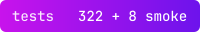
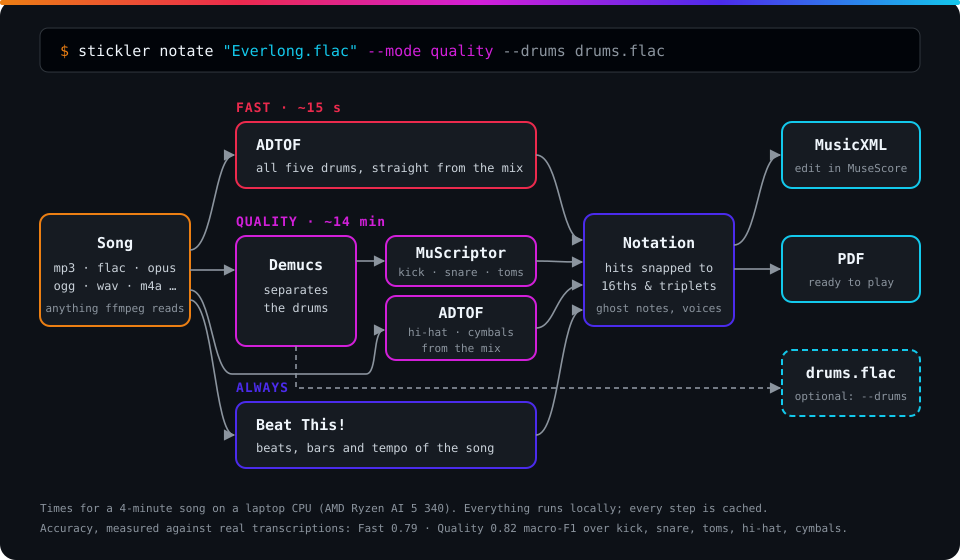

<h1 align="center">
  <code>STICKLER://DRUMS</code>
</h1>

<p align="center">
  <strong>Song in, sheet music out. Local, with open-source models.</strong><br/>
  <em>Stickler: a pedant. And someone who holds the sticks.</em>
</p>

<p align="center">
  <a href="LICENSE"></a>
  
  
  
  
  
  
  
</p>

<p align="center">
  
  
  
  
  
  
  
</p>

<p align="center"><sub>Badges: <a href="scripts/badges.py">scripts/badges.py</a>, rendered with <a href="https://shieldcn.dev">shieldcn</a>.</sub></p>

<br/>

<pre align="center">
<code>
  ╔═════════════════════════════════════════════════════════════════════════════╗
  ║                                                                             ║
  ║        ███████╗████████╗██╗ ██████╗██╗  ██╗██╗     ███████╗██████╗          ║
  ║        ██╔════╝╚══██╔══╝██║██╔════╝██║ ██╔╝██║     ██╔════╝██╔══██╗         ║
  ║        ███████╗   ██║   ██║██║     █████╔╝ ██║     █████╗  ██████╔╝         ║
  ║        ╚════██║   ██║   ██║██║     ██╔═██╗ ██║     ██╔══╝  ██╔══██╗         ║
  ║        ███████║   ██║   ██║╚██████╗██║  ██╗███████╗███████╗██║  ██║         ║
  ║        ╚══════╝   ╚═╝   ╚═╝ ╚═════╝╚═╝  ╚═╝╚══════╝╚══════╝╚═╝  ╚═╝         ║
  ║                                                                             ║
  ║                       🥁 SONG IN  //  SHEET MUSIC OUT                       ║
  ║         DRUM SHEET MUSIC FROM ANY SONG  //  OPEN SOURCE  //  LOCAL          ║
  ║                                                                             ║
  ╚═════════════════════════════════════════════════════════════════════════════╝
</code>
</pre>

---

## `> WHAT IS THIS`

**Stickler** turns a song into drum sheet music: give it an MP3, FLAC, Opus, M4A or any other audio
file, get the notes as MusicXML or PDF, and only correct them in MuseScore. Everything runs locally, with open-source models.

**It started as a test bench**, because one question cannot be settled by reading papers:
**which combination of drum separation and transcription model produces the best notes?** Every
model lives in its own adapter with its own Python environment and competes against the same
references (kick, snare, toms, hi-hat and cymbals, every hit accurate to ±50 ms), on benchmark
data and, above all, on real music. The answer is in: see [`> RESULTS`](#-results).

**Next:** release 1 as a command line tool with a *Fast* and a *Quality* mode; after it, the
desktop application with a GTK 4 interface, shipped as Flatpak and AppImage.

Only **open-source models from actively maintained projects** are allowed. No cloud service, no
black box; everything runs on your own machine.

---

## `> WHY`

I'm a beginner on the drums. Do you know how hard it is to find sheet music for even slightly
niche music?
I do, because I looked.

Then I found a few services that can transcribe songs into sheet music. But I'm not crazy
enough to spend €20 when I already have an active AI subscription.

And just like that, the thought was born: rebuilding this can't be rocket science. Even
better: locally, so it runs on my own PC.

A dream come true.

---

## `> WARNINGS`

> **⚠ NOT PERFECT.** About three in four hits come out right on real rock, metal and pop
> recordings. The notes are a starting point to correct in MuseScore, not a finished score.

> **⚠ MODEL LICENSES.** Stickler never ships model weights; `stickler setup` downloads them, and
> each comes with its own license. Some are non-commercial (ADTOF, MuScriptor, presumably
> BS-RoFormer), see [ADR 0002](docs/adr/0002-nc-lizenzen.md).

> **⚠ TRAINING OVERLAP.** Some models may have seen MDB Drums or ENST-Drums during training. The
> honest test is your own songs.

---

## `> RESULTS`

Macro-F1 over 5 classes (kick, snare, toms, hi-hat, cymbals). Time: a 4-minute song on a laptop
CPU (AMD Ryzen AI 5 340).

| Mode | Pipeline | Own songs¹ | MDB Drums | ENST-Drums² | Time |
|---|---|---|---|---|---|
| **Fast** (default) | ADTOF on the original mix | 0.770 | 0.718 | **0.810** | ~15 s |
| **Quality** | MuScriptor medium on the Demucs stem for kick, snare and toms, ADTOF on the mix for hi-hat and cymbals | **0.776** | **0.785** | 0.783 | ~14 min |

¹ 25 commercial rock, metal and pop recordings, references from musescore.com transcriptions.
² Drummer 3, the part no model was trained on.

- **ADTOF is the strongest single model**, and on real recordings it works best on the original
  mix. **Quality** is only slightly better on real music (better on 16, worse on 2 of 25 songs,
  mostly the snare), at about 56 times the computing time. Try it when Fast misses things in a
  particular song.
- **Snapping to the beat grid** for the sheet music costs almost nothing.
- **Clever tricks did not help on real music:** fusing inputs, voting between models, tuning
  thresholds and filling in repeated bars all looked good on MDB and did not transfer to rock
  and metal. Details, per-instrument tables and every decision: [**benchmark report**](docs/report.md).

On the laptop's Radeon 840M every model was slower on the GPU than on the CPU
([ADR 0003](docs/adr/0003-rocm-kanal.md)); NVIDIA GPUs speed up the slow models 10–30×.

---

## `> HOW IT WORKS`

<p align="center">
  
</p>

**Behind it, the benchmark** that picked these models:

```
  Song ──┬──► Separation ─────► Drum stem ───► Transcription ────► drums.mid
         │    none · demucs     (or mix)       adtof · adt_str              │
         │    roformer · oracle                muscriptor                   │
         │                                                                  ▼
         └──► Beat tracking ──► beats.json ──────────────────────► Scoring against
              beat_this                                            the reference
                                                                   ±50 ms · 5/3 classes
```

- **One adapter per model.** Each model gets a folder with its own `pyproject.toml` and its own
  `uv` environment. The harness calls it as a subprocess and never imports model code. A new
  candidate only needs a folder and a config entry.
- **Everything is cached.** The key made from the input's content and the adapter's code
  determines whether a result is reused, on any device. An interrupted run resumes where it
  stopped.
- **Failures don't block anything.** An adapter that crashes or hits its time limit is logged. All
  others keep computing.

---

## `> CANDIDATES`

| Stage | Adapter | Project | License |
|---|---|---|---|
| Separation | `demucs` | [adefossez/demucs](https://github.com/adefossez/demucs) 4.1, `htdemucs_ft` (maintained fork) | MIT |
| Separation | `roformer` | [python-audio-separator](https://github.com/nomadkaraoke/python-audio-separator), BS-Roformer-SW | MIT / weights unclear |
| Transcription | `adtof` | [ADTOF-pytorch](https://github.com/xavriley/ADTOF-pytorch) (Zehren et al.) | CC BY-NC-SA |
| Transcription | `adt_str` | [ADT_STR](https://huggingface.co/Pierfrancesco/adt-str) (2026), τ = 0.8 | CC BY-SA |
| Transcription | `muscriptor_s`, `muscriptor_m` | [MuScriptor](https://github.com/muscriptor/muscriptor) (Kyutai/IRCAM, 2026) | MIT / weights CC BY-NC |
| ~~Transcription~~ | ~~`yourmt3`~~ | YourMT3+, removed 2026-11-13: last on the own songs, outdated dependencies with known vulnerabilities; results stay in the [report](docs/report.md) | – |
| Beats | `beat_this` | [Beat This!](https://github.com/CPJKU/beat_this) (CPJKU, 2024) | MIT |

Every model decision that was not obvious is recorded as an ADR in [`docs/adr/`](docs/adr/).
Source, version and own measurements are in the README of the respective adapter.

---

## `> OWN SONGS`

Benchmark data is clean, real music is not. That is why Stickler also compares against your own
songs: sheet music as MIDI from musescore.com, and a recording from your own collection.

The problem is that notes and recording don't line up. Intros are missing, tempos drift, and
transcribers leave passages out. `stickler align` therefore lays the notes onto the recording,
hit by hit. It is based on the beats from Beat This! and the rhythm patterns in the Demucs stem,
linked via DTW. Passages without a counterpart are excluded.

**Only good references make it into the scoring.** Checking is done without a transcription
model, so the models are not their own examiners. The thresholds are calibrated on MDB, whose
references are demonstrably correct:

| Criterion | Threshold |
|---|---|
| Paired note beats that sit cleanly on the recording (±70 ms) | ≥ 95% |
| Note hits with an audible attack in the drum stem (±50 ms) | ≥ 85% |
| Clear attacks in the stem that appear in the notes | ≥ 90% |
| Evaluated music (excluded passages do not count) | ≥ 2 min |

Passages that only exist in the sheet music, such as extra repeats, are dropped from the
reference. They are reported, but they are no reason to reject a song.
If the automatic checks are fooled, for example by a bass bleeding into the drum stem, a
song can be approved by ear after listening to its `click.wav`.

To check by ear, `stickler align` writes a `click.wav` per song: the recording on the left, clicks
on the note hits on the right.

---

## `> KEY FIGURES`

```console
scripts/check.sh task
```

```json
{
  "adapter": { "separation": 2, "transcription": 4, "beats": 1 },
  "datasets": { "mdb_drums": 23, "enst_drums": 64, "own_songs": 25 },
  "tests": 351,
  "smoke_tests_with_models": 8,
  "coverage_percent": 97,
  "coverage_minimum": 95,
  "adrs": 6,
  "version": 0,
  "status": "CLI release 1 in preparation"
}
```

| Key | Meaning |
|---|---|
| `smoke_tests_with_models` | Runs real models, therefore not part of the default run: `uv run pytest -m adapters` |
| `coverage_minimum` | Below this, the pre-commit hook blocks. Limit and rules in [`CONSTRAINTS.md`](CONSTRAINTS.md) |
| `own_songs` | Described in `references/own/`. Only songs that pass the quality criteria enter the scoring |

---

## `> ROADMAP`

**Done**

- [x] Scoring by class, cache, time limits, error log, HTML report
- [x] Separators Demucs and BS-RoFormer; transcribers ADTOF, ADT_STR, MuScriptor (YourMT3+ measured, then removed)
- [x] Beat tracking with Beat This!, alignment and quality criteria for own songs
- [x] Full runs over MDB Drums and the own songs; GPU runs on rented hardware
- [x] Combinations, fusion, voting, tuning and bar consensus measured (section 6 of the report)
- [x] Sheet music: quantization, MusicXML, PDF via MuseScore, drum track export (`stickler notate`)
- [x] Everything in English; report, CLI guide and requirements in [`docs/`](docs/)

**In progress**

- [ ] ENST-Drums as a third dataset, 15 more own songs
- [x] `stickler notate --mode fast|quality`
- [ ] **Release 1:** the command line tool

**Afterwards: the application**

- [ ] Finer classes for the sheet music (open/closed hi-hat, ride/crash)
- [ ] Repeat signs for readable sheet music
- [ ] Design the interface together, following the GNOME Human Interface Guidelines
- [ ] Application with a GTK 4 and libadwaita interface, Fast/Quality modes, app icon in GNOME style, export of the separated drum track
- [ ] Release pipeline: Flatpak and AppImage with every release
- [ ] Ultrareview of the finished application

---

## `> BUILD IT YOURSELF`

> **Documentation:** [CLI guide](docs/cli.md) · [Requirements](docs/requirements.md) ·
> [Benchmark report](docs/report.md) ·
> [Contributing](CONTRIBUTING.md) (issues welcome, no pull requests)

### Prerequisites

Stickler needs **`uv`** for the Python environments and **`ffmpeg`** to decode audio. Everything
else, including Python 3.12 and PyTorch, `uv` fetches for each adapter itself.

**Fedora, Bluefin and related**

```console
brew install uv          # or: curl -LsSf https://astral.sh/uv/install.sh | sh
sudo dnf install ffmpeg-free
```

**Debian, Ubuntu and related**

```console
curl -LsSf https://astral.sh/uv/install.sh | sh
sudo apt install ffmpeg
```

### Setup

```console
git clone https://github.com/niklastshiang/stickler.git
cd stickler/
uv sync
git config core.hooksPath .githooks    # checks before every commit
uv run stickler fetch mdb              # download MDB Drums (CC BY-NC-SA)
uv run stickler setup                  # all adapter environments and weights
uv run stickler doctor                 # what's still missing?
```

> MuScriptor weights are gated: accept the license on Hugging Face, then run `uvx hf auth login`.
> The GPU setup is optional: `stickler setup --device cuda` (NVIDIA) or `--device rocm` (AMD).
> Disk, memory and time per mode: [requirements](docs/requirements.md).

### Benchmark

```console
uv run stickler run      # computes the matrix from config/benchmark.yaml (overnight)
uv run stickler eval     # results/metrics.csv and results/summary.csv
uv run stickler align    # align own songs, check them and write click.wav
uv run stickler notate song.mp3                  # sheet music (MusicXML, PDF), Fast mode
uv run stickler notate song.mp3 --mode quality --drums drums.flac   # more accurate, plus drum track
uv run stickler report   # results/report.html
```

---

## `> ORIGIN`

<p align="center">
  
  
  
</p>

**The code of this project comes from an AI.** It was programmed, tested and documented by Claude
(Anthropic) in Claude Code.

The project owner provides the goals, the selection of candidates and the songs. He makes the
decisions and checks the results by ear. To keep the code from quietly getting worse, firm
guardrails apply:

- **Specification first, then code.** What gets built is set out in [`SPEC.md`](SPEC.md), the plan
  in [`tasks/`](tasks/). Decisions made are recorded in [`docs/adr/`](docs/adr/).
- **Tests first** and a minimum coverage of 95%.
- **A floor guard checks every diff.** It triggers when checks are silenced, tests are skipped or
  limits are lowered. Such a commit is blocked, see [`CONSTRAINTS.md`](CONSTRAINTS.md).
- **Measure, don't assert.** Every model choice is justified by measurements, even when the
  result is inconvenient.

---

## `> REPOSITORY LAYOUT`

```
stickler/
├── src/stickler/        # Harness: api, cli, runner, align, onsets, evaluate, datasets/
├── adapters/            # one folder per model, each with its own uv environment
│   ├── _common/         # shared helpers: device selection, meta.json, drum MIDI
│   ├── separators/      # demucs, roformer
│   ├── transcribers/    # adtof, adt_str, muscriptor_s, muscriptor_m
│   └── beats/           # beat_this
├── config/              # benchmark, own and enst configs; classes.yaml (GM pitch → class)
├── references/own/      # own songs: title, recording, manual exclusions
├── tests/               # pytest; smoke tests with real models under -m adapters
├── scripts/             # check.sh, floor_guard.py
├── docs/                # report, CLI guide, requirements; adr/: decision records
├── tasks/               # plan and task list
└── data/ cache/ results/   # datasets, intermediate results, evaluation (not in the repo)
```

---

## `> LICENSE`

**The code of Stickler** is under [**MIT**](LICENSE). This covers the harness, adapters, scripts,
tests and documentation. Using, modifying, redistributing and selling it is permitted, as long as
the copyright notice stays intact.

**The models** are not affected by this. Stickler only downloads them on `stickler setup`; they
are not in the repository and come with their own licenses, see
[`> CANDIDATES`](#-candidates). Some weights are non-commercial
([ADR 0002](docs/adr/0002-nc-lizenzen.md)): whoever downloads them is bound by those terms, and a
package that bundles them must respect them too.

**Data:** MDB Drums is under CC BY-NC-SA 4.0, ENST-Drums under CC BY-NC-ND 4.0 (research only;
`stickler fetch` downloads both). Sheet music and recordings of your own songs belong to their authors and are
therefore not in the repository.

---

## `> SUPPORT MY WORK`

Nobody reads this anyway. But if you ever run into me in real life, feel free to buy me a
burger. 🍔

---

<p align="center">
  <strong><code>> ONE, TWO, THREE, FOUR. THE STICKLER IS COUNTING._</code></strong>
</p>
