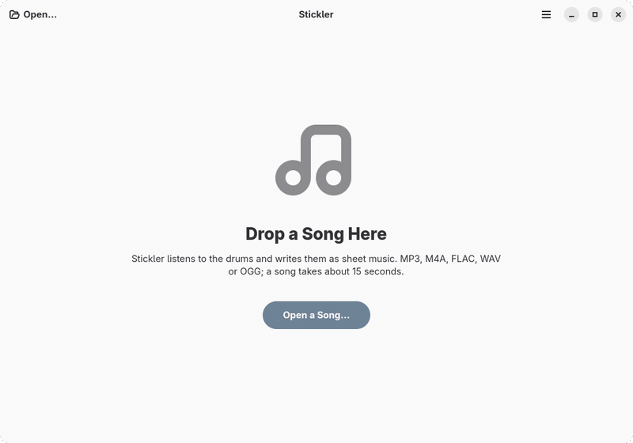
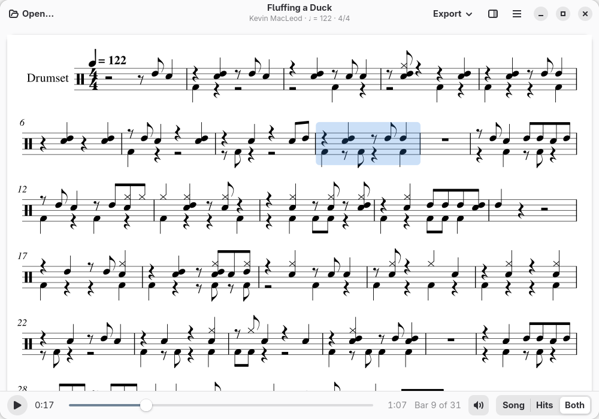
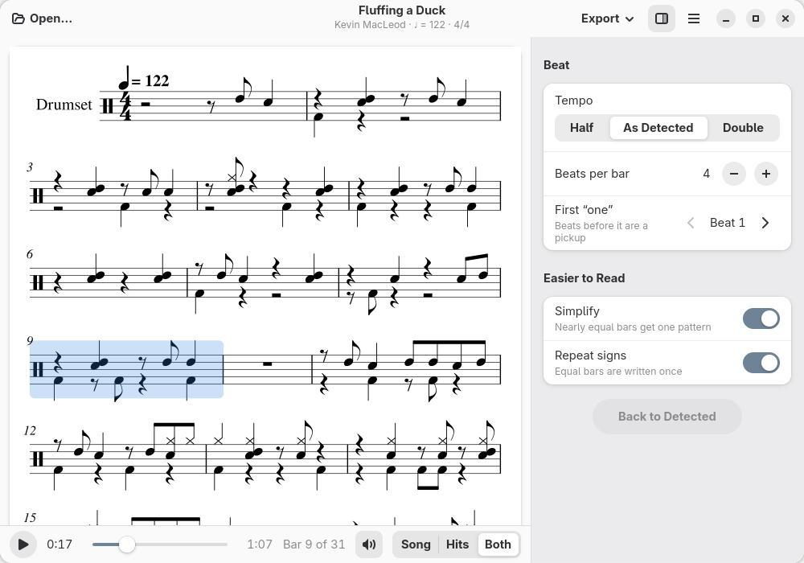
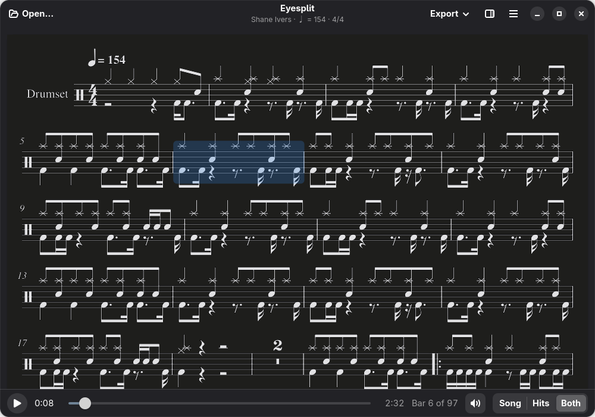
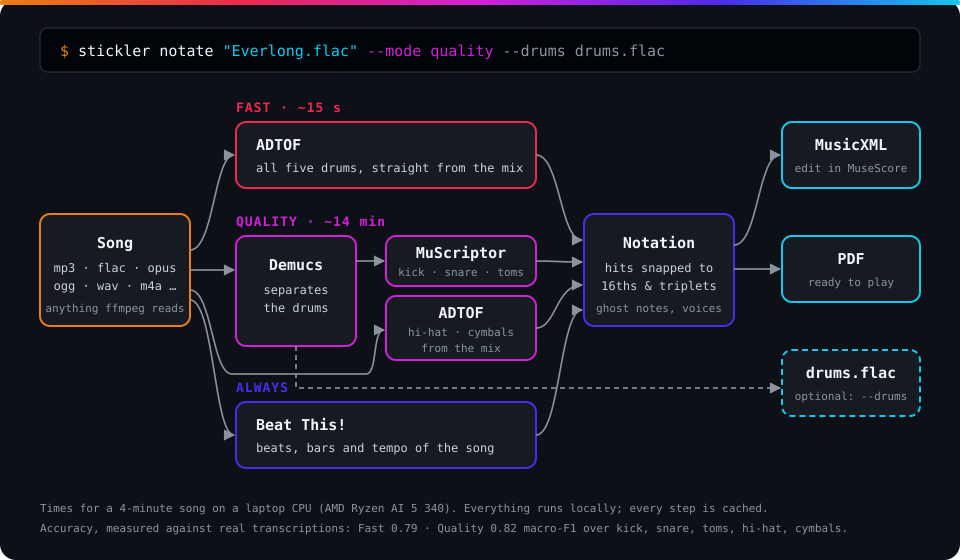

<p align="center">
  
</p>

<p align="center">
  
</p>

<h1 align="center">
  <code>STICKLER://DRUMS</code>
</h1>

<p align="center">
  <strong>Song in, sheet music out. Local, with open-source models.</strong><br/>
  <em>Stickler: a pedant. And someone who holds the sticks.</em>
</p>

<p align="center">
  <a href="LICENSE"></a>
  
  
  <a href="https://github.com/niklastshiang/stickler/releases/latest"></a>
  
</p>

<p align="center">
  
</p>

<p align="center"><sub>Badges: <a href="scripts/badges.py">scripts/badges.py</a>, rendered with <a href="https://shieldcn.dev">shieldcn</a>.</sub></p>

<p align="center">
  <a href="#-install-the-app"><strong>Install</strong></a> ·
  <a href="#-the-app">The app</a> ·
  <a href="#-results">Results</a> ·
  <a href="docs/cli.md">CLI guide</a> ·
  <a href="docs/report.md">Benchmark report</a> ·
  <a href="https://github.com/niklastshiang/stickler/releases">Releases</a>
</p>

---

## `> WHAT IS THIS`

**Stickler** turns a song into drum sheet music: give it an MP3, FLAC, Opus, M4A or any other audio
file, get the notes as MusicXML or PDF, and only correct them in MuseScore. Everything runs locally, with open-source models.

On real rock, metal and pop recordings about three in four hits match third-party
transcriptions, and judged by ear about 87 % are right (see [`> RESULTS`](#-results)): the notes
are a good first draft to finish in MuseScore, not a finished score.

It started as a test bench, because one question cannot be settled by reading papers: which
combination of drum separation and transcription model produces the best notes? Every model
lives in its own adapter with its own Python environment and competes against the same
references (kick, snare, toms, hi-hat and cymbals, every hit accurate to ±50 ms), on benchmark
data and, above all, on real music. The results are below, in [`> RESULTS`](#-results).

The desktop app writes the drums of a song as sheet music for drummers who never open a
terminal: drop a song in, play along with the detected hits, export a PDF. It comes for Linux as a Flatpak,
an AppImage, a `.deb` for Ubuntu and an `.rpm` for Fedora, and as a native app for the Mac, see
[`> INSTALL THE APP`](#-install-the-app).

Stickler only uses open-source models from actively maintained projects.

---

## `> THE APP`

<p align="center">
  
  
  
</p>

<p align="center"><sub><b>Play along</b>: the bar that sounds is marked &nbsp;·&nbsp; <b>Correct</b>: tempo, meter and the first beat, without analysing again &nbsp;·&nbsp; <b>Dark</b>: follows the system</sub></p>

<p align="center"><sub>The song is "Eyesplit" by Shane Ivers (<a href="https://www.silvermansound.com">silvermansound.com</a>), <a href="https://creativecommons.org/licenses/by/4.0/">CC BY 4.0</a>; the notes are Stickler's transcription of its drums.</sub></p>

**How it goes**

1. Open a song, or drop it onto the window. The first time, Stickler asks to download its models.
2. Wait about 15 seconds while it detects the hits, finds the beat and writes the notes.
3. Play along: the bar that sounds is marked. Wrong tempo, meter or first beat? Fix it in the
   corrections sidebar, without analysing again.
4. Export the sheet music as PDF or MusicXML, or the separated drum track as FLAC or WAV.

---

## `> INSTALL THE APP`

Every [release](https://github.com/niklastshiang/stickler/releases) has the app for Linux on
x86_64, in four forms, and for a Mac with Apple silicon. On first start it asks to
download its two models once; after that it runs offline. Stickler ships no model itself, and each comes with its own licence, which the app names
before the download; some are for non-commercial use only (see [`> LICENSE`](#-license)).

| What | How much |
|---|---|
| System | Linux on x86_64 (the `.deb`: Ubuntu 26.04 or newer; the `.rpm`: Fedora 44 or newer), or a Mac with Apple silicon and macOS 26 |
| Download on first start | about 2.2 GB on Linux (ADTOF and Beat This!); the app names the size before it downloads |
| First drum-track export | about 1.2 GB more (Demucs) |
| Memory | about 1 GB while a song is analysed |
| Also needed | nothing: no Python, `uv` or ffmpeg to install; the Flatpak takes the GNOME 51 runtime from Flathub, the `.deb` and `.rpm` take Python, GTK and ffmpeg from the system |

More on disk, memory and time: [requirements](docs/requirements.md).

**Ubuntu** (26.04 or newer) and **Fedora** (44 or newer): download `Stickler-<version>_amd64.deb`
or `Stickler-<version>.x86_64.rpm` and open it with the Software app, or install it in a
terminal; the package manager brings what Stickler needs from the system. Use one way to install
Stickler, not the Flatpak as well: both would show up in the app menu.

```bash
sudo apt install ./Stickler-9_amd64.deb      # Ubuntu
sudo dnf install ./Stickler-9.x86_64.rpm     # Fedora
```

**Flatpak** (recommended on GNOME): download `Stickler-<version>.flatpak` and open it with GNOME
Software, or install it in a terminal; the GNOME runtime comes from Flathub:

```bash
flatpak install --user Stickler-9.flatpak
```

**AppImage** (any distribution): download `Stickler-<version>-x86_64.AppImage`, make it executable
and start it.

```bash
chmod +x Stickler-9-x86_64.AppImage && ./Stickler-9-x86_64.AppImage
```

**Mac**: download `Stickler-<version>.dmg`, open it and drag Stickler to
Applications. macOS blocks the first start of an app that is not from the App Store: allow it
once under **System Settings › Privacy & Security › Open Anyway**. The steps one by one, and
what to do when that button is missing: [Installing Stickler on a Mac](docs/install-macos.md).

### Removing it

To free the models' space but keep the app, choose **Remove Downloaded Models…** in its main
menu (every Linux package); a check box there removes the settings, recent songs and
corrections too.

**Mac:** choose **Remove Downloaded Models…** in the Stickler menu with its box ticked, then
drag Stickler from Applications to the Bin.

**Flatpak:** one command removes the app with its models, results and settings:

```bash
flatpak uninstall --delete-data ng.tshia.Stickler
```

<details>
<summary><b>Ubuntu, Fedora</b>: remove the package and Stickler's folders</summary>

Remove it with the Software app or in a terminal, then Stickler's three folders as for the
AppImage below:

```bash
sudo apt remove stickler     # Ubuntu
sudo dnf remove stickler     # Fedora
```

</details>

<details>
<summary><b>AppImage</b>: delete the file and Stickler's folders</summary>

Delete the file, then Stickler's three folders (the models, with the Python and
downloads they were set up with, are in the first two):

```bash
rm -r ~/.local/share/stickler ~/.cache/stickler ~/.config/stickler
```

</details>

---

## `> WHY`

I'm a beginner on the drums. Do you know how hard it is to find sheet music for even slightly
niche music?
I do, because I looked.

Then I found a few services that can transcribe songs into sheet music. But I'm not crazy
enough to spend €20 when I already have an active AI subscription.

And just like that, the thought was born: rebuilding this can't be rocket science. Even
better: locally, so it runs on my own PC.

A dream come true.

---

## `> RESULTS`

Macro-F1 over 5 classes (kick, snare, toms, hi-hat, cymbals). Time: a 4-minute song on a laptop
CPU (AMD Ryzen AI 5 340).

| Mode | Pipeline | Own songs¹ | MDB Drums | ENST-Drums² | Time |
|---|---|---|---|---|---|
| **Fast** (default) | ADTOF on the original mix | 0.770 | 0.718 | **0.810** | ~15 s |
| **Quality** | MuScriptor medium on the Demucs stem for kick, snare and toms, ADTOF on the mix for hi-hat and cymbals | **0.776** | **0.785** | 0.783 | ~14 min |

¹ 25 commercial rock, metal and pop recordings, references from musescore.com transcriptions.
Corrected for errors in these references (release 3, 100 spots judged blind by ear): Fast 0.867,
Quality 0.842.
² Drummer 3, the part no model was trained on. Some models may have seen MDB Drums or the other
ENST-Drums parts during training, so the own songs are the fairest test.

- **ADTOF is the strongest single model**, and on real recordings it works best on the original
  mix. **Quality** is only slightly better against the references (better on 16, worse on 2 of
  25 songs, mostly the snare), at about 56 times the computing time; corrected for reference
  errors, Fast is ahead. Try Quality when Fast misses things in a particular song.
- **The references are the weak spot:** about half of the disagreements judged by ear were errors
  of the transcriptions. Fast gets about 87 % of the hits right on real music, not 77 %.
<details>
<summary><b>More findings</b>: newer models, snapping, fusion, GPUs</summary>

- **Newer models did not beat the modes** (release 7): MuScriptor large 0.704, DrumSep with onset
  detection 0.589 on the own songs; Separate-and-Detect stayed far behind on MDB. MuScriptor
  large is the strongest single model on MDB but weaker than ADTOF at hi-hat and cymbals on real
  songs.
- **Snapping to the beat grid** for the sheet music costs almost nothing.
- **Fusion, voting, threshold tuning and bar filling did not help on real music:** they all
  looked good on MDB and did not transfer to rock and metal. Details, per-instrument tables and every decision: [**benchmark report**](docs/report.md).

On the laptop's Radeon 840M every model was slower on the GPU than on the CPU
([ADR 0003](docs/adr/0003-rocm-kanal.md)); NVIDIA GPUs speed up the slow models 10–30×.

</details>

---

## `> HOW IT WORKS`

<p align="center">
  
</p>

**Behind it, the benchmark** that picked these models:

```
  Song ──┬──► Separation ─────► Drum stem ───► Transcription ────► drums.mid
         │    none · demucs     (or mix)       adtof · adt_str              │
         │    roformer · oracle                muscriptor                   │
         │                                                                  ▼
         └──► Beat tracking ──► beats.json ──────────────────────► Scoring against
              beat_this                                            the reference
                                                                   ±50 ms · 5/3 classes
```

- **One adapter per model.** Each model gets a folder with its own `pyproject.toml` and its own
  `uv` environment. The harness calls it as a subprocess and never imports model code. A new
  candidate only needs a folder and a config entry.
- **Everything is cached.** The key made from the input's content and the adapter's code
  determines whether a result is reused, on any device. An interrupted run resumes where it
  stopped.
- **Failures don't block anything.** An adapter that crashes or hits its time limit is logged. All
  others keep computing.

---

## `> CANDIDATES`

| Stage | Adapter | Project | License |
|---|---|---|---|
| Separation | `demucs` | [adefossez/demucs](https://github.com/adefossez/demucs) 4.1, `htdemucs_ft` (maintained fork) | MIT |
| Separation | `roformer` | [python-audio-separator](https://github.com/nomadkaraoke/python-audio-separator), BS-Roformer-SW | MIT / weights unclear |
| Transcription | `adtof` | [ADTOF-pytorch](https://github.com/xavriley/ADTOF-pytorch) (Zehren et al.) | CC BY-NC-SA |
| Transcription | `adt_str` | [ADT_STR](https://huggingface.co/Pierfrancesco/adt-str) (2026), τ = 0.8 | CC BY-SA |
| Transcription | `muscriptor_s`, `muscriptor_m`, `muscriptor_l` | [MuScriptor](https://github.com/muscriptor/muscriptor) (Kyutai/IRCAM, 2026); large since release 7 | MIT / weights CC BY-NC |
| Transcription | `drumsep_onset` | [MDX23C DrumSep](https://github.com/nomadkaraoke/python-audio-separator) (aufr33/jarredou) with onsets per drum stem (release 7) | MIT / weights unclear |
| Transcription | `sad` | [Separate-and-Detect](https://github.com/ddman1101/Separate-and-detect) (Hsu et al., 2026; release 7) | MIT |
| ~~Transcription~~ | ~~`yourmt3`~~ | YourMT3+, removed 2026-11-13: last on the own songs, outdated dependencies with known vulnerabilities; results stay in the [report](docs/report.md) | – |
| Beats | `beat_this` | [Beat This!](https://github.com/CPJKU/beat_this) (CPJKU, 2024) | MIT |

Every model decision that was not obvious is recorded as an ADR in [`docs/adr/`](docs/adr/).
Source, version and own measurements are in the README of the respective adapter.

---

## `> ROADMAP`

**Next**

- [ ] Quality mode in the app (today it runs Fast)
- [ ] Finer classes for the sheet music (open/closed hi-hat, ride/crash)
- [ ] Ultrareview of the finished application

<details>
<summary><b>Done</b>: releases 1–9</summary>

**Done**

- [x] Scoring by class, cache, time limits, error log, HTML report
- [x] Separators Demucs and BS-RoFormer; transcribers ADTOF, ADT_STR, MuScriptor (YourMT3+ measured, then removed)
- [x] Beat tracking with Beat This!, alignment and quality criteria for own songs
- [x] Full runs over MDB Drums and the own songs; GPU runs on rented hardware
- [x] Combinations, fusion, voting, tuning and bar consensus measured (section 6 of the report)
- [x] Sheet music: quantization, MusicXML, PDF via MuseScore, drum track export (`stickler notate`)
- [x] Everything in English; report, CLI guide and requirements in [`docs/`](docs/)

**Release 1**

- [x] ENST-Drums as a third dataset, 25 own songs
- [x] `stickler notate --mode fast|quality`
- [x] **Release 1:** the command line tool

**Release 2**

- [x] Readable sheet music: similar bars simplified, repeat signs (about a quarter fewer bars)
- [x] **Release 2:** readable sheet music

**Release 3**

- [x] Error analysis on real songs: confused, missed and invented hits, reference errors judged blind by ear (`stickler errors`, `stickler listen`, with badges)
- [x] **Release 3:** honest numbers

**Release 4**

- [x] Groundwork for the app: progress, cancelling and setup for every long step

**Release 5: the application**

- [x] Design the interface together, following the GNOME Human Interface Guidelines
- [x] Application with a GTK 4 and libadwaita interface: sheet music, playback with the detected hits, corrections, export of PDF, MusicXML and the separated drum track, app icon in GNOME style
- [x] English, German and Spanish
- [x] A first-run assistant that downloads the models
- [x] Release pipeline: Flatpak and AppImage with every release
- [x] **Release 5:** the desktop app

**Release 6**

- [x] Click volume that follows the song's loudness; the band's name in the PDF; removing the models from the app
- [x] **Release 6:** polish for the app

**Release 7**

- [x] New candidate models: DrumSep with onset detection, MuScriptor large, Separate-and-Detect (none beats Fast or Quality on real songs)
- [x] The app starts the models without a network connection
- [x] **Release 7:** new candidates

**Release 8**

- [x] A native macOS app (SwiftUI) over the same core: sheet music with zoom and pinch, exports, the setup assistant, English, German and Spanish
- [x] A `.dmg` for Apple silicon that brings its own Python, `uv` and ffmpeg

**Release 9**

- [x] A `.deb` for Ubuntu and an `.rpm` for Fedora, tested in clean systems before every release
- [x] **Release 8:** the Mac app

</details>

---

## `> BUILD IT YOURSELF`

> **Documentation:** [CLI guide](docs/cli.md) · [Requirements](docs/requirements.md) ·
> [Benchmark report](docs/report.md) ·
> [Contributing](CONTRIBUTING.md) (issues welcome, no pull requests)

### Prerequisites

Stickler needs **`uv`** for the Python environments and **`ffmpeg`** to decode audio. Everything
else, including Python (3.14 for ADTOF, Beat This! and Demucs, which the app uses; 3.12 for the
four benchmark-only models) and PyTorch, `uv` fetches for each adapter itself.

**Fedora, Bluefin and related**

```console
brew install uv          # or: curl -LsSf https://astral.sh/uv/install.sh | sh
sudo dnf install ffmpeg-free
```

**Debian, Ubuntu and related**

```console
curl -LsSf https://astral.sh/uv/install.sh | sh
sudo apt install ffmpeg
```

### Setup

```console
git clone https://github.com/niklastshiang/stickler.git
cd stickler/
uv sync
git config core.hooksPath .githooks    # checks before every commit
uv run stickler fetch mdb              # download MDB Drums (CC BY-NC-SA)
uv run stickler setup                  # all adapter environments and weights
uv run stickler doctor                 # what's still missing?
uv tool install --editable .           # optional: `stickler` in every folder
```

> MuScriptor weights are gated: accept the license on Hugging Face, then run `uvx hf auth login`.
> The GPU setup is optional: `stickler setup --device cuda` (NVIDIA) or `--device rocm` (AMD).
> Disk, memory and time per mode: [requirements](docs/requirements.md).

<details>
<summary><b>Benchmark</b>: run the models, score them, write the report</summary>

```console
uv run stickler run      # computes the matrix from config/benchmark.yaml (overnight)
uv run stickler eval     # results/metrics.csv and results/summary.csv
uv run stickler align    # align own songs, check them and write click.wav
uv run stickler notate song.mp3                  # sheet music (MusicXML, PDF), Fast mode
uv run stickler notate song.mp3 --mode quality --drums drums.flac   # more accurate, plus drum track
uv run stickler report   # results/report.html
```

</details>

---

## `> ORIGIN`

<p align="center">
  
  
  
  
  
</p>

The code of this project comes from an AI: Claude (Anthropic) programmed, tested and documented
it in Claude Code.

The project owner provides the goals, the selection of candidates and the songs, makes the
decisions and checks the results by ear.

<details>
<summary><b>How the code is kept honest</b>: four rules the repository enforces</summary>

To keep the code from quietly getting worse, the repository enforces four rules:

- **Specification first, then code.** What gets built is set out in [`SPEC.md`](SPEC.md), the plan
  in [`tasks/`](tasks/). Decisions made are recorded in [`docs/adr/`](docs/adr/).
- **Tests first** and a minimum coverage of 95%.
- **A floor guard checks every diff.** It triggers when checks are silenced, tests are skipped or
  limits are lowered. Such a commit is blocked, see [`CONSTRAINTS.md`](CONSTRAINTS.md).
- **Measure, don't assert.** Every model choice is justified by measurements, even when the
  result is inconvenient: after the correction for reference errors Fast beat Quality, and
  tuning that helped on MDB was dropped because it hurt real music.

</details>

<details>
<summary><b>What the AI cost</b>: about 478 USD at API prices for release 9</summary>

Claude Code logs the tokens of every response;
[`scripts/ai_usage.py`](scripts/ai_usage.py) sums them and prices them with Anthropic's
[API prices](https://platform.claude.com/docs/en/about-claude/pricing). Every computer that works
on Stickler records its days in [`docs/usage/`](docs/usage/), and the table adds them up. The logs
reach back to 13 November 2026; the first two days of the project (the command line tool's start)
are missing. On a subscription the real cost differs; this is what the same work would cost on
the API.

| Period | Model | Responses | Output tokens | Cache read | API cost |
|---|---|---:|---:|---:|---:|
| 13–22 Nov 2026 | Claude Opus 5.5 (the work, reviews; Linux) | 3,100 | 2.8 M | 1,102 M | 332 USD |
| 13–22 Nov 2026 | Claude Fable 5.2 (research subagents; Linux) | 135 | 0.31 M | 17 M | 33 USD |
| 19–20 Nov 2026 | Claude Fable 5.2 (on the Mac) | 610 | 0.63 M | 153 M | 87 USD |
| 19–20 Nov 2026 | Claude Opus 5.5 (on the Mac) | 196 | 0.11 M | 61 M | 26 USD |
| | **Total, release 9** (1,348 M tokens, about 31 hours active) | | | | **about 478 USD** |

</details>

---

## `> MORE DETAILS`

<details>
<summary><b>Own songs</b>: why real recordings count, and how they are aligned and checked</summary>

Benchmark data is clean, real music is not. That is why Stickler also compares against your own
songs: sheet music as MIDI from musescore.com, and a recording from your own collection.

The problem is that notes and recording don't line up. Intros are missing, tempos drift, and
transcribers leave passages out. `stickler align` therefore lays the notes onto the recording,
hit by hit. It is based on the beats from Beat This! and the rhythm patterns in the Demucs stem,
linked via DTW. Passages without a counterpart are excluded.

**Only good references make it into the scoring.** Checking is done without a transcription
model, so the models are not their own examiners. The thresholds are calibrated on MDB, whose
references are demonstrably correct:

| Criterion | Threshold |
|---|---|
| Paired note beats that sit cleanly on the recording (±70 ms) | ≥ 95% |
| Note hits with an audible attack in the drum stem (±50 ms) | ≥ 85% |
| Clear attacks in the stem that appear in the notes | ≥ 90% |
| Evaluated music (excluded passages do not count) | ≥ 2 min |

Passages that only exist in the sheet music, such as extra repeats, are dropped from the
reference. They are reported, but they are no reason to reject a song.
If the automatic checks are fooled, for example by a bass bleeding into the drum stem, a
song can be approved by ear after listening to its `click.wav`.

To check by ear, `stickler align` writes a `click.wav` per song: the recording on the left, clicks
on the note hits on the right.

</details>

<details>
<summary><b>Key figures</b>: tests, datasets and coverage of the last release, for developers</summary>

```console
scripts/check.sh task
```

```json
{
  "adapter": { "separation": 2, "transcription": 7, "beats": 1 },
  "datasets": { "mdb_drums": 23, "enst_drums": 64, "own_songs": 25 },
  "tests": 1103,
  "app_widget_tests": 51,
  "smoke_tests_with_models": 12,
  "mac_tests": 146,
  "coverage_percent": 98,
  "coverage_minimum": 95,
  "adrs": 8,
  "version": 9,
  "status": "release 9: Linux packages"
}
```

| Key | Meaning |
|---|---|
| `app_widget_tests` | The GTK app's windows, on an invisible screen: `scripts/gtk.sh test` |
| `smoke_tests_with_models` | Runs real models, therefore not part of the default run: `uv run pytest -m adapters` |
| `mac_tests` | The Mac app's: `SticklerCore` (89, `swift test`, on Linux and macOS) and the app with its screenshots (57), run by the workflow `mac` |
| `coverage_minimum` | Below this, the pre-commit hook blocks. Limit and rules in [`CONSTRAINTS.md`](CONSTRAINTS.md) |
| `own_songs` | Described in `references/own/`. Only songs that pass the quality criteria enter the scoring |

</details>

<details>
<summary><b>Repository layout</b>: where what is</summary>

```
stickler/
├── src/stickler/        # Harness: api, cli, runner, align, onsets, evaluate, datasets/
├── src/stickler_app/    # the app logic shared by both apps (no GTK, tested)
├── src/stickler_gtk/    # the GTK app: ui/ (widgets)
├── adapters/            # one folder per model, each with its own uv environment
│   ├── _common/         # shared helpers: device selection, meta.json, drum MIDI
│   ├── separators/      # demucs, roformer
│   ├── transcribers/    # adtof, adt_str, muscriptor_s/_m/_l, drumsep_onset, sad
│   └── beats/           # beat_this
├── config/              # benchmark, own and enst configs
├── mac/                 # the macOS app (release 8): SticklerCore, the SwiftUI app
├── po/                  # translations (German, Spanish), po/LINGUAS lists them
├── packaging/           # Flatpak manifest, AppStream MetaInfo, desktop file, icons, font
├── references/own/      # own songs: title, recording, manual exclusions
├── tests/               # pytest; smoke tests with real models under -m adapters
├── scripts/             # check.sh, floor_guard.py, gtk.sh (run the app), appimage.sh, i18n.sh, …
├── docs/                # report, CLI guide, requirements; adr/: decision records
├── tasks/               # plan and task list
└── data/ cache/ results/   # datasets, intermediate results, evaluation (not in the repo)
```

</details>

---

## `> LICENSE`

**The code of Stickler** is under the [**GNU General Public License, version 3 or later**](LICENSE)
(GPL-3.0-or-later), from release 5 on; releases 1–4 were published under MIT and stay so. This
covers the harness, adapters, scripts, tests, the app and the documentation. You may use, study,
change and share it, also commercially; whoever passes on a changed version must pass it on under
the same licence, with its source code. Copyright © 2026 Niklas Tshiang Tshiananga.

**The models** are not affected by this. Stickler only downloads them when you agree on the
app's first start or run `stickler setup`; they
are not in the repository and come with their own licenses, see
[`> CANDIDATES`](#-candidates). Some weights are non-commercial
([ADR 0002](docs/adr/0002-nc-lizenzen.md)): whoever downloads them is bound by those terms, and a
package that bundles them must respect them too.

**Data:** MDB Drums is under CC BY-NC-SA 4.0, ENST-Drums under CC BY-NC-ND 4.0 (research only;
`stickler fetch` downloads both). Sheet music and recordings of your own songs belong to their authors and are
therefore not in the repository.

---

## `> SUPPORT MY WORK`

Nobody reads this anyway. But if you ever run into me in real life, feel free to buy me a
burger. 🍔

---

<p align="center">
  <a href="https://github.com/niklastshiang/stickler/releases">Releases</a> ·
  <a href="https://github.com/niklastshiang/stickler/issues">Report a bug</a> ·
  <a href="docs/cli.md">CLI guide</a> ·
  <a href="docs/report.md">Benchmark report</a> ·
  <a href="CONTRIBUTING.md">Contributing</a>
</p>

<p align="center">
  <strong><code>> ONE, TWO, THREE, FOUR. THE STICKLER IS COUNTING._</code></strong>
</p>
